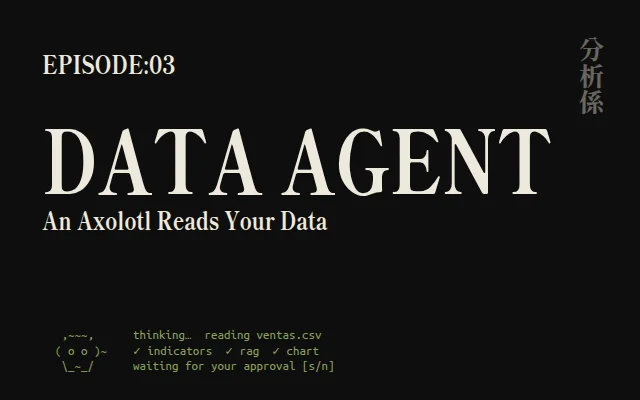
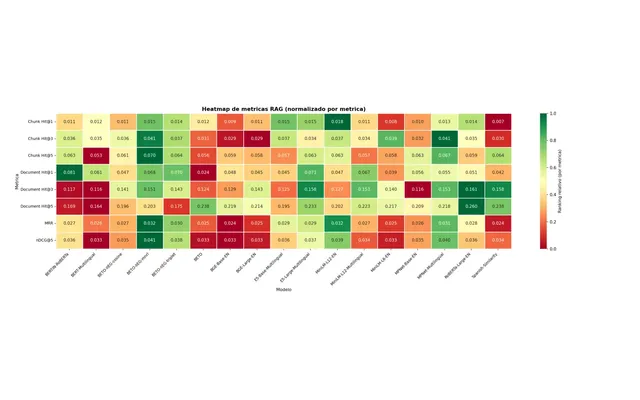
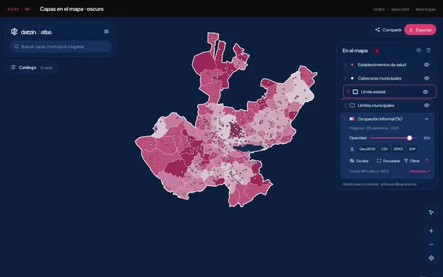
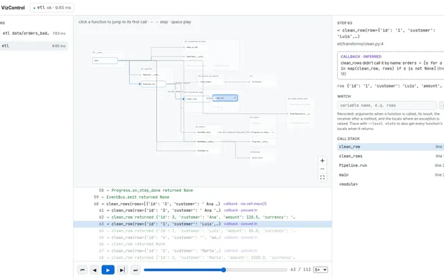
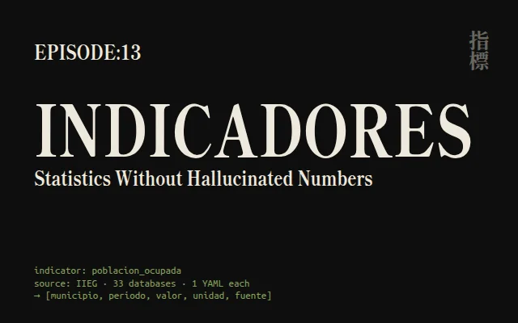

## Hi, I'm Alejandro 👋

AI Engineer from Guadalajara, Mexico. I build retrieval systems, agents and MCP servers, plus
the less glamorous parts that keep them running: APIs, data pipelines, geospatial databases
and Linux boxes. Most of what I build speaks Spanish.

- 🏛️ **AI Developer @ [IIEG](https://iieg.gob.mx)**: GenAI over Jalisco's public data (RAG, agents, MCP servers)
- 🦎 **Co-founder @ [Datzin](https://datzin.com.mx)**: a software studio with an axolotl mascot (this is the closest emoji, sorry)
- 🧩 **Consultant @ Ixti**: client systems, automation, geospatial ML
- 🎓 **M.Sc. @ UdeG**: Spanish embeddings that help agents pick the right tool

### Things you should know about me

- 🤖 **AI nerd.** I spend more time as a *markdown manager* than as a software engineer. It's the natural evolution of *"spent 10 hours automating a 5-minute task"* into *"spend longer writing skills and agents than writing code, so my AI codes the way I like."*
- 🟣 **Evangelion fan.** Very. Veeeeery. (Yes, there's a MAGI further down.)
- 🎮 **Gamer.** Recovered League of Legends player, jungle/top. Quitting is the greatest achievement of my life. These days: Pokémon, The Binding of Isaac, Minecraft, Assassin's Creed, Hollow Knight…
- 🖥️ **Hardware and homelabbing**, one of my questionable life decisions.
- 🐈 **One cat.** He hates me, except when he decides he doesn't. That's the real kind of love.
- 🍳 **I love cooking.** It's like dev: three hours of work for something that's gone in five minutes.
- 🧠 **Expert in nothing, I dabble in everything.** We're here to learn.

### What runs on me

## Episodes

#### Agents and AI tooling

<table>
  <tr>
    <td width="33%" valign="top">
      
       <b><a href="https://github.com/zamax14/claude-decide">Laya / claude-decide</a></b>
       A 322M local model picks which skills and MCP tools Claude Code needs for each request. −39% tokens and −37% cost on Opus. <a href="https://huggingface.co/Zamax14/laya-context-prefilter">🤗 model</a>
    </td>
    <td width="33%" valign="top">
      
       <b><a href="https://github.com/zamax14/MAGI-Agent">MAGI</a></b>
       Three Claude agents (a dev, a blind tester and a docs reviewer) deliberate on your branch before a human does. Told you.
    </td>
    <td width="33%" valign="top">
      
       <b>Data Agent</b> <code>private</code>
       Local-first data analyst on Deep Agents + Ollama: predefined indicators (no free-form SQL), hybrid RAG with BM25 and embeddings, Plotly charts, report templates and human approvals. An ASCII axolotl shows you what it's doing.
    </td>
  </tr>
</table>

#### Research

<table>
  <tr>
    <td width="33%" valign="top">
      
    </td>
    <td valign="top">
      <b>Spanish embeddings for agentic tool selection</b> <code>M.Sc. thesis · private</code>
       If an agent retrieves the right context and the right tool, it needs fewer tokens to get the job done. The pipeline:
       
        1. <a href="https://github.com/zamax14/SyntheticDataLLM">SyntheticDataLLM</a> turns documents into Spanish Q&amp;A with local models 
        2. Fine-tune BETO and E5 with MNRL, cosine and triplet losses 
        3. Evaluate context retrieval over 3,530 chunks and tool retrieval among a ReAct agent's 24 BI tools plus distractors (FAISS vs BM25, Hit@K, MRR, nDCG), on a DGX A100 via SLURM
      
       Laya (above) started as the practical side of the same question.
    </td>
  </tr>
</table>

#### Datzin, open source

<table>
  <tr>
    <td width="33%" valign="top">
      
       <b><a href="https://github.com/DatzinDev/Atlas">Atlas</a></b>
       PostGIS layers as WMS, WFS and vector tiles from inside FastAPI. No GeoServer. Powers <a href="https://densimap.datzin.com.mx">DensiMap</a>.
    </td>
    <td width="33%" valign="top">
      
       <b><a href="https://github.com/DatzinDev/VizControl">VizControl</a></b>
       Record a Python run, then replay it in the browser step by step, like a debugger after the fact.
    </td>
    <td width="33%" valign="top">
      
       <b><a href="https://github.com/DatzinDev/EIC-API-MCP">EIC-API-MCP</a></b>
       INEGI's intercensal survey behind DuckDB, FastAPI and FastMCP, so any AI assistant can query it. <a href="https://eic.datzin.com.mx">Live</a>.
    </td>
  </tr>
</table>

#### IIEG, public sector

<table>
  <tr>
    <td width="33%" valign="top">
      
       <b><a href="https://github.com/iieg-oficial/minerva">Minerva</a></b>
       OAuth2/OIDC identity provider for a whole state institute: PKCE, JWKS key rotation and a FastAPI SDK, so no system re-implements login again.
    </td>
    <td width="33%" valign="top">
      
       <b><a href="https://github.com/iieg-oficial/Indicadores_SIEEJ">Indicadores SIEEJ</a></b>
       Official statistics as an MCP server and REST API. One YAML per indicator and one output contract across 33 databases, so agents never make up a number.
    </td>
    <td width="33%" valign="top">
       <b>…and more</b>
       Corkbit (Kanban + thermal printer + MCP), airflow-mcp, ETL pipelines, road-sign detection, talks and workshops. They all live in my <a href="https://zamax14.github.io/Portafolio/">portfolio</a>.
    </td>
  </tr>
</table>

---

  <a href="https://zamax14.github.io/Portafolio/">Portfolio</a> ·
  <a href="https://www.linkedin.com/in/alexzaratem14">LinkedIn</a> ·
  <a href="https://datzin.com.mx">Datzin</a> ·
  <a href="https://huggingface.co/Zamax14">🤗 Hugging Face</a> ·
  <a href="mailto:zarate.alejandroM14@gmail.com">Email</a>

