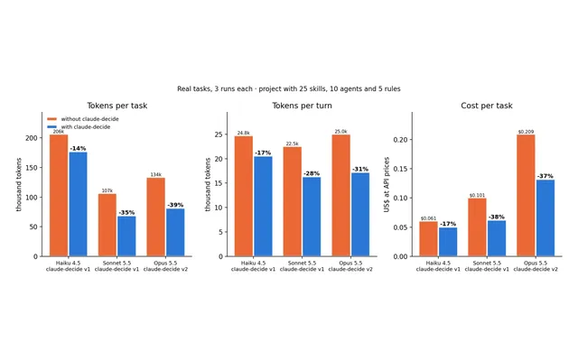
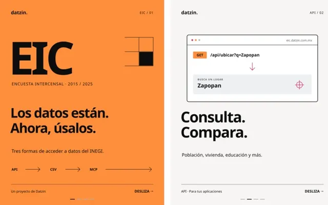
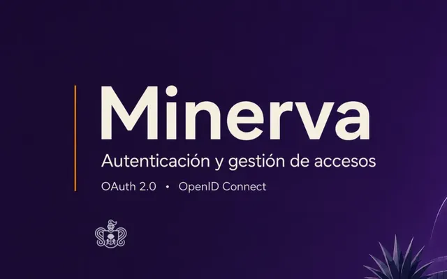

## Hi, I'm Alejandro 👋

AI Engineer from Guadalajara, Mexico. I build retrieval systems, agents and MCP servers, plus the
unglamorous parts that keep them alive. Most of it speaks Spanish.

- 🏛️ **[IIEG](https://iieg.gob.mx)**: AI Engineer + Software Dev + Data Engineer + whatever's needed that week
- 🦎 **[Datzin](https://datzin.com.mx)**: co-founder, aspiring tech communicator, maker of for-fun projects in case one of them turns into something someday (closest emoji to an axolotl, sorry)
- 🧩 **Ixti**: AI consultant
- 🎓 **UdeG**: M.Sc. thesis on Spanish embeddings that help agents pick the right tool

### Things you should know about me

- 🤖 **AI nerd.** I'm more *markdown manager* than software engineer now. It's the natural evolution of *"10 hours automating a 5-minute task"* into *"more time writing skills and agents than code, so my AI codes the way I like."*
- 🟣 **Evangelion fan.** Very. Veeeeery. (There's a MAGI further down.)
- 🎮 **Gamer.** Recovered League player, jungle/top. Quitting was the greatest achievement of my life. Now: Pokémon, Binding of Isaac, Minecraft, Assassin's Creed, Hollow Knight.
- 🖥️ **Hardware and homelab**, one of my questionable life decisions.
- 🐈 **One cat.** He hates me until he decides he doesn't. Real love.
- 🍳 **Cooking.** Like dev: three hours of work, gone in five minutes.
- 🧠 **Expert in nothing, I dabble in everything.** We're here to learn.

### Toolbox

I don't ask AI for code and hope for the best. I design the system and write the skills, rules and agents, and the harness does the typing. **Architect of what the AI builds.**

<code>$ dmesg | tail</code>

 

## Episodes

#### Agents and AI tooling

<table>
  <tr>
    <td width="33%" valign="top">
      
       <b><a href="https://github.com/zamax14/claude-decide">Laya / claude-decide</a></b>
       A 322M local model picks which skills and tools Claude Code needs. −39% tokens on Opus. <a href="https://huggingface.co/Zamax14/laya-context-prefilter">🤗</a>
    </td>
    <td width="33%" valign="top">
      
       <b><a href="https://github.com/zamax14/MAGI-Agent">MAGI</a></b>
       Three Claude agents (dev, blind tester, docs) vote on your branch before a human does. Told you.
    </td>
    <td width="33%" valign="top">
      
       <b>Data Agent</b> <code>private</code>
       A local-first data analyst built on Deep Agents + Ollama. It handles indicators, hybrid RAG, charts and reports, and asks you before acting. An ASCII axolotl narrates.
    </td>
  </tr>
</table>

#### Research

<table>
  <tr>
    <td width="40%" valign="top">
      
    </td>
    <td valign="top">
      <b>Spanish embeddings for agentic tool selection</b> <code>M.Sc. thesis · private</code>
       My fine-tuned Spanish embedding model picks the right tool out of 213 (24 real, 189 decoys) with <b>MRR@5 0.87</b>. The best off-the-shelf model gets 0.44, and BM25 gets 0.36.
       Pipeline: <a href="https://github.com/zamax14/SyntheticDataLLM">SyntheticDataLLM</a> (Spanish Q&amp;A from documents) → fine-tuning E5/BETO → retrieval and tool-selection benchmarks on a DGX A100.
    </td>
  </tr>
</table>

#### Datzin, open source

<table>
  <tr>
    <td width="33%" valign="top">
      
       <b><a href="https://github.com/DatzinDev/Atlas">Atlas</a></b>
       Serves PostGIS layers as WMS, WFS and vector tiles from FastAPI, with no GeoServer. Powers <a href="https://densimap.datzin.com.mx">DensiMap</a>.
    </td>
    <td width="33%" valign="top">
      
       <b><a href="https://github.com/DatzinDev/VizControl">VizControl</a></b>
       Records a Python run so you can replay it in the browser, like a debugger after the fact.
    </td>
    <td width="33%" valign="top">
      
       <b><a href="https://github.com/DatzinDev/EIC-API-MCP">EIC-API-MCP</a></b>
       Mexico's intercensal survey, served with DuckDB, FastAPI and MCP so any AI assistant can query it. <a href="https://eic.datzin.com.mx">Live</a>.
    </td>
  </tr>
</table>

#### IIEG, public sector

<table>
  <tr>
    <td width="33%" valign="top">
      
       <b><a href="https://github.com/iieg-oficial/minerva">Minerva</a></b>
       OAuth2/OIDC identity provider for a whole institute. With it, nobody has to build login again.
    </td>
    <td width="33%" valign="top">
      
       <b><a href="https://github.com/iieg-oficial/Indicadores_SIEEJ">Indicadores SIEEJ</a></b>
       Official statistics served as an MCP server, so agents quote real numbers and never invent them.
    </td>
    <td width="33%" valign="top">
       <b>…and more</b>
       Corkbit, airflow-mcp, ETL pipelines, road-sign detection, talks and workshops, all in my <a href="https://zamax14.github.io/Portafolio/">portfolio</a>.
    </td>
  </tr>
</table>

---

  <a href="https://zamax14.github.io/Portafolio/">Portfolio</a> ·
  <a href="https://www.linkedin.com/in/alexzaratem14">LinkedIn</a> ·
  <a href="https://datzin.com.mx">Datzin</a> ·
  <a href="https://huggingface.co/Zamax14">🤗 Hugging Face</a> ·
  <a href="mailto:zarate.alejandroM14@gmail.com">Email</a>

