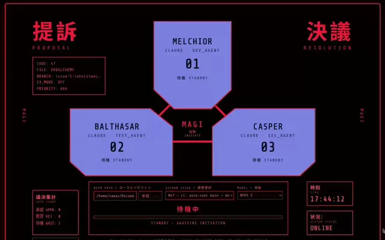
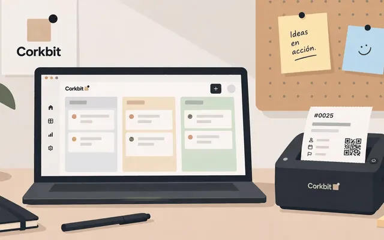
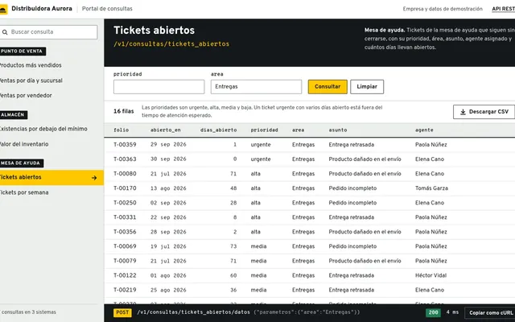
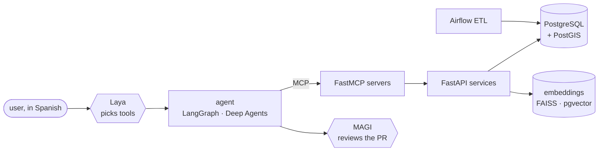

<a href="https://zamax14.github.io/Portafolio/"></a>

```console
zamax@gdl:~$ neofetch
```

```yaml
OS:        ZamaxOS 2026 (Guadalajara, MX)
Host:      IIEG — AI Developer
Side:      Datzin — co-founder · Ixti — consultant
Kernel:    Python 3.12 / FastAPI
Shell:     RAG · agents · MCP
DB:        PostgreSQL + PostGIS
Research:  Spanish embeddings for agentic tool selection (M.Sc., UdeG)
Uptime:    5 years shipping · 4,753 contributions in the last 12 months
```

I build retrieval systems, agents and MCP servers, and the boring parts that keep them
standing: APIs, data pipelines, geospatial databases, Linux boxes. Most of what I build speaks Spanish.

> **The portfolio is a desktop.** [zamax14.github.io/Portafolio](https://zamax14.github.io/Portafolio/):
> open the folders, type in the terminal, or walk the pixel-art Guadalajara to each stage of my work.

## Now airing

<table>
  <tr>
    <td width="33%" valign="top">
      <a href="https://github.com/zamax14/claude-decide"></a>
      <br><sub><code>EP.01</code></sub> <b><a href="https://github.com/zamax14/claude-decide">Laya / claude-decide</a></b>
      <br><sub>A 322M local model picks which skills and MCP tools Claude Code needs. −39% tokens, −37% cost on Opus. <a href="https://huggingface.co/Zamax14/laya-context-prefilter">🤗 model</a></sub>
    </td>
    <td width="33%" valign="top">
      <a href="https://github.com/zamax14/MAGI-Agent"></a>
      <br><sub><code>EP.02</code></sub> <b><a href="https://github.com/zamax14/MAGI-Agent">MAGI</a></b>
      <br><sub>Three Claude agents (dev, blind tester, docs) deliberate on your branch before a human does.</sub>
    </td>
    <td width="33%" valign="top">
      <a href="https://github.com/zamax14/Corkbit"></a>
      <br><sub><code>EP.03</code></sub> <b><a href="https://github.com/zamax14/Corkbit">Corkbit</a></b>
      <br><sub>Kanban + thermal printer + MCP server. Your agent works on the same board, and new tasks print out.</sub>
    </td>
  </tr>
  <tr>
    <td valign="top">
      <a href="https://github.com/DatzinDev/VizControl"></a>
      <br><sub><code>EP.06</code></sub> <b><a href="https://github.com/DatzinDev/VizControl">VizControl</a></b>
      <br><sub>Record a Python run, replay it in the browser like a debugger after the fact.</sub>
    </td>
    <td valign="top">
      <a href="https://github.com/DatzinDev/Atlas"></a>
      <br><sub><code>EP.07</code></sub> <b><a href="https://github.com/DatzinDev/Atlas">Atlas</a></b>
      <br><sub>PostGIS layers as WMS, WFS and vector tiles from inside FastAPI. No GeoServer. Powers <a href="https://densimap.datzin.com.mx">DensiMap</a>.</sub>
    </td>
    <td valign="top">
      <a href="https://github.com/zamax14/MCP-MexAI"></a>
      <br><sub><code>EP.22</code></sub> <b><a href="https://github.com/zamax14/MCP-MexAI">MCP-MexAI</a></b>
      <br><sub>Talk + demo: one YAML per query → REST → MCP, so ChatGPT and Claude can use your internal systems.</sub>
    </td>
  </tr>
</table>

<details>
<summary><b>More episodes</b>: MCP servers, institutional systems, research</summary>

| | Project | What it does |
|---|---|---|
| 🧭 | [EIC-API-MCP](https://github.com/DatzinDev/EIC-API-MCP) | INEGI's intercensal survey behind DuckDB + FastAPI + FastMCP. [Live](https://eic.datzin.com.mx) |
| 🔑 | [Minerva](https://github.com/iieg-oficial/minerva) | OAuth2/OIDC identity provider for a whole state institute: PKCE, JWKS rotation, FastAPI SDK |
| 📊 | [Indicadores SIEEJ](https://github.com/iieg-oficial/Indicadores_SIEEJ) | Official statistics as an MCP server, so agents query numbers without hallucinating them |
| 🌬️ | [airflow-mcp](https://github.com/zamax14/airflow-mcp) | Operate Airflow 2/3 from any MCP client; write tools ask before acting |
| 🧪 | [SyntheticDataLLM](https://github.com/zamax14/SyntheticDataLLM) | Documents → Spanish Q&A datasets with local models. Stage one of my thesis pipeline |
| 🎓 | [AI-Jalisco](https://github.com/zamax14/AI-Jalisco) | Workshop: from a chat to an API to an agent to an MCP server |
| 🛟 | [OpenDesk](https://github.com/DatzinDev/OpenDesk) | Open-source helpdesk with SLAs, approvals and CSAT |

</details>

## How a request moves through my stuff



## Toolbox

[](https://zamax14.github.io/Portafolio/)

<sub>LangChain · LangGraph · Deep Agents · FastMCP · SentenceTransformers · FAISS · Airflow · DuckDB · ONNX Runtime · MLflow · DVC · Claude Code</sub>

## Find me

[Portfolio](https://zamax14.github.io/Portafolio/) · [LinkedIn](https://www.linkedin.com/in/alexzaratem14) · [Datzin](https://datzin.com.mx) · [🤗 Hugging Face](https://huggingface.co/Zamax14) · [Email](mailto:zarate.alejandroM14@gmail.com)

<sub><i>God's in his heaven. All's right with the world.</i> (prod is green)</sub>
